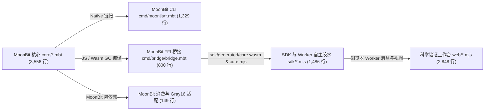

# MoonJLS MoonBit 原生实现地图 / MoonBit Implementation Map

本文档说明 MoonJLS 为何以 **MoonBit** 作为唯一核心编解码语言、JPEG-LS Part 1 各核心算法模块在 `.mbt` 源码中的精确分布、三后端（Native / JS / Wasm GC）如何复用同一份 MoonBit 核心、JavaScript/TypeScript 宿主层的真实边界，以及排除测试报告、构建产物与脚本后的真实源码统计。

## 1. 核心结论

- **100% JPEG-LS 编解码算法均由纯 MoonBit 实现**：包括帧级/扫描级参数分离、上下文建模（365 个常规上下文 + 2 个游程中断上下文，每扫描重新初始化）、MED 边缘自适应预测、梯度量化表 `q_lut`、Golomb-Rice 熵编解码、`0xFF` 位填充、游程（Run）与游程中断（Run Interruption）模式、SOI/SOF55(1–255 分量)/LSE1 跨扫描继承/多 SOS/EOI/扫描间 DRI=0·COM·APPn 流式标记解析与定位、块大小无关的暂停/恢复状态机与严格尾随检查。
- **JavaScript / TypeScript 不包含任何 JPEG-LS 编解码数学逻辑**：`sdk/*.mjs` 仅负责加载 `cmd/bridge` 编译出的 `core.mjs` / `core.wasm`、搬运 `Uint8Array` / `Uint16Array` 分块、执行 Web Worker 背压协议与生成 `moonjls.verification/1` JSON 报告；`web/*.mjs` 仅负责浏览器科学工作台 UI、P6 PPM 宿主平面转换、Scan Structure Inspector、有界预览采样与本地下载。
- **三后端共享同一份 `core/`**：Native CLI（`cmd/moonjls`）直接链接 `core`；JS 与 Wasm GC 通过薄 FFI 端口（`cmd/bridge`）从同一份 `core` 编译产出。同一组输入和策略下，三后端输出逐字节一致。

## 2. JPEG-LS 核心算法模块与符号地图

| JPEG-LS 模块 / 职责 | 标准定位 | MoonBit 源码文件 | 核心类型与函数符号 | 行数 |
| --- | --- | --- | --- | ---: |
| 帧/扫描参数、`ComponentSpec`、`ScanInfo`、`StreamStructure`、`ErrorLocation` 与溢出安全校验 | §4.3.2、C.2.2–C.2.4、Table C.1–C.2 | [core/parameters.mbt](../core/parameters.mbt) | `Frame`、`FrameInfo`、`ComponentSpec`、`ScanSpec`、`ScanInfo`、`StreamStructure`、`ErrorLocation`、`Preset`、`Limits`、`checked_total_samples`、`validate_frame_dimensions` | 407 |
| 预测行缓冲、MED 预测、梯度量化、常规/游程上下文更新、误差映射与工作区统计 | Annex A.2–A.5 | [core/model.mbt](../core/model.mbt) | `Scan`、`Scan::workspace_bytes`、`quantize_gradient`、`med_predict`、`Scan::context_id`、`Parameters::reduce`、`Parameters::reconstruct`、`golomb_order`、`Scan::update_regular`、`Scan::update_run`、`map_regular`、`unmap_regular` | 344 |
| 位级读写、`0xFF` 后一位填充、Golomb-Rice 编解码器与标准段写出（含扫描/帧边界分离） | Annex A.5.3、C.2.1–C.2.4 | [core/bits.mbt](../core/bits.mbt) | `BitWriter`、`BitWriter::frame_header`、`BitWriter::lse1`、`BitWriter::scan_header_for`、`BitWriter::finish_scan`、`BitWriter::finish_frame`、`BitReader::reset`、`GolombReader::reset` | 262 |
| 流式标记解析、跨扫描原始 `LSE1` 零字段继承与扫描/分量映射 | Annex B、Annex C、T.81 标记语法 | [core/markers.mbt](../core/markers.mbt) | `HeaderParser`、`HeaderParser::begin_inter_scan`、`frame_segment`、`preset_segment`、`scan_segment`、`finish_segment`、`accept` | 420 |
| 多扫描流式编码状态机（`finish_scan`/`finish_frame` 隔离、跨扫描 LSE1、分块输入输出、暂停/取消） | Annex A、流式契约 | [core/encoder.mbt](../core/encoder.mbt) | `Encoder`、`Encoder::new`、`Encoder::new_multicomponent`、`Encoder::scan_index`、`Encoder::workspace_bytes`、`Encoder::step` | 892 |
| 多扫描流式解码状态机（扫描间合法标记恢复、提前 EOI/终标记检查、准确错误定位、逐行借出） | Annex A、流式契约 | [core/decoder.mbt](../core/decoder.mbt) | `Decoder`、`Decoder::new`、`Decoder::frame_info`、`Decoder::scans`、`Decoder::current_scan`、`Decoder::structure`、`Decoder::error_location`、`Decoder::step` | 1,020 |
| 整图同步便捷入口（单分量及多分量 `ILV=0`） | 应用层整图封装 | [core/image.mbt](../core/image.mbt) | `encode`、`decode`、`decode_with_preset`、`encode_multicomponent`、`decode_multicomponent`、`inspect` | 211 |
| 核心白盒与参数回归测试（18 项测试在 JS / Wasm GC / Native 全部执行） | M0–M3-A 核心语义 | [core/multiscan_wbtest.mbt](../core/multiscan_wbtest.mbt) [core/preset_wbtest.mbt](../core/preset_wbtest.mbt) [core/stream_wbtest.mbt](../core/stream_wbtest.mbt) [core/workspace_wbtest.mbt](../core/workspace_wbtest.mbt) | 2/3/4 分量、非连续 ID、重排扫描、`LSE1` 继承与零重置、`0xFF 0x00` 扫间断点、工作区与负数边界 | 930 |
| Native 流式 CLI、planar/PGM/P6 PPM IO 与 `--json` 结构检查 | Native 宿主入口 | [cmd/moonjls/main.mbt](../cmd/moonjls/main.mbt) [cmd/moonjls/files.mbt](../cmd/moonjls/files.mbt) | `encode-planar`、`encode-pgms`、`encode-ppm`、`decode-pgms`、`inspect`/`verify --json`、`Source` | 1,329 |
| JS & Wasm GC 无状态转换 FFI 端口（新增结构/扫描/定位检查与打包行搬运） | JS / Wasm GC 编译边界 | [cmd/bridge/bridge.mbt](../cmd/bridge/bridge.mbt) | `encoder_builder_*`、`decoder_component_*`、`decoder_scan_*`、`decoder_structure_offset`、`decoder_marker_*`、`decoder_error_*` | 800 |
| 独立 MoonBit 消费模块与 `MoonImage Gray16` 适配器 | 生态集成与消费验证 | [examples/consumer/gray16/gray16.mbt](../examples/consumer/gray16/gray16.mbt) [examples/consumer/main.mbt](../examples/consumer/main.mbt) [tests/conformance/consumer_m2.mbt](../tests/conformance/consumer_m2.mbt) | `encode`、`decode`、`main` | 149 |

## 3. JavaScript / TypeScript 宿主层职责（不含编解码算法）

- **SDK 胶水与协议层（[sdk/index.mjs](../sdk/index.mjs)、[sdk/cli.mjs](../sdk/cli.mjs)、[sdk/worker.mjs](../sdk/worker.mjs)、[sdk/worker-client.mjs](../sdk/worker-client.mjs)）**：实例化 MoonBit 编译生成的 `sdk/generated/core.mjs` / `core.wasm`，管理分块缓冲区、`encodePlanarImage`/`decodePlanarImage`/`inspectStream`、Web Worker 扫描边界批冲洗、逐行 `ack` 背压及严格尾随检测。
- **报告与月球元数据层（[sdk/verification-report.mjs](../sdk/verification-report.mjs)、[sdk/report-node.mjs](../sdk/report-node.mjs)、[sdk/lunar.mjs](../sdk/lunar.mjs)、`sdk/*.d.mts`）**：生成并校验 `moonjls.verification/1` JSON 报告（含 M3-A 扫描、误差定位与宿主转换缓存字段），以及识别 NASA LOLA PGM 物理定标元数据。
- **浏览器科学工作台 UI（[web/app.mjs](../web/app.mjs)、[web/ppm.mjs](../web/ppm.mjs)、[web/scan-inspector.mjs](../web/scan-inspector.mjs)、[web/compatibility.mjs](../web/compatibility.mjs)、[web/labels.mjs](../web/labels.mjs)、[web/pgm.mjs](../web/pgm.mjs)、[web/preview.mjs](../web/preview.mjs)、[web/run-report.mjs](../web/run-report.mjs)、[web/transport.mjs](../web/transport.mjs)）**：提供 Precision Lab、Multicomponent Channel Switcher、Scan Structure Inspector、Streaming Lab、Compatibility Lab 与有界样本核对。

## 4. 真实源码统计（基于受测 M3-A 提交 `36bb9e6` 实测）

统计口径排除 `node_modules`、`_build`、`web/dist`、`sdk/generated`、二进制夹具与报告快照（直接对仓库已跟踪源码统计）：

| 代码分类 | 文件数 | 总行数 | 字节数 | 说明 |
| --- | ---: | ---: | ---: | --- |
| **MoonBit 核心编解码源码**（`core/*.mbt` 不含测试） | 7 | **3,556** | 101,379 | 全部 JPEG-LS 算法与 M3-A 多扫描状态机 |
| **MoonBit CLI 与 FFI 桥接**（`cmd/**/*.mbt`） | 3 | **2,129** | 62,134 | Native 可执行程序与 JS/Wasm GC 导出端口 |
| **MoonBit 核心单元测试**（`core/*_wbtest.mbt`） | 4 | **930** | 31,832 | 18 项跨三后端核心回归测试 |
| **MoonBit 消费示例与包验证**（`examples/**/*.mbt`、`tests/**/*.mbt`） | 3 | **149** | 5,631 | 独立包消费与 `MoonImage Gray16` 适配 |
| **MoonBit 源码合计（`.mbt`）** | **17** | **6,764** | **200,976** | **产品核心唯一实现语言** |
| SDK 宿主运行时（`sdk/*.mjs` 不含 `build.mjs`） | 7 | 1,486 | 59,641 | FFI 加载、Worker 背压协议、CLI 与报告契约 |
| Web 科学工作台运行时 JS（`web/*.mjs` 运行时 9 个文件） | 9 | 2,848 | 118,206 | 浏览器工作台、PPM P6 转换、Scan Inspector 与有界预览 |

## 5. GitHub Linguist 语言栏说明

- GitHub 语言检测支持识别 MoonBit（`MoonBit: 64,773` 字节已出现在 GitHub `/languages` API 统计中）。
- 在合入 PR #1 之前，仓库默认分支 `main` 处于 M2 之前的旧基线（`60befa6`），尚无 `.gitattributes` 与 M2 MoonBit 增量；且仓库内保留了多轮浏览器工作台截图、RC2/RC3/Presentation 验证快照与浏览器/Python 验收脚本（见 `reports/` 与 `REVIEW_EVIDENCE/`），因此合并前默认页显示的 JavaScript 占比较高。
- 本仓库通过合法的 [`.gitattributes`](../.gitattributes) 仅将真正属于文档/归档报告和构建产物的路径标记为 `linguist-documentation`（`reports/**`、`REVIEW_EVIDENCE/**`、`submission/**`）与 `linguist-generated=true`（`sdk/generated/**`、`web/dist/**`），合入 `main` 后由 GitHub Linguist 依法重新计算，绝不将生成文件伪装为 MoonBit 源码，也不改变 `scripts/` 与 `web/` 等真实 JS/Python 代码的语言分类。
