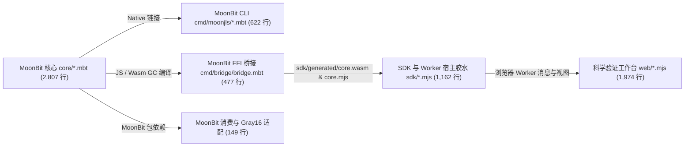

# MoonJLS MoonBit 原生实现地图 / MoonBit Implementation Map

本文档说明 MoonJLS 为何以 **MoonBit** 作为唯一核心编解码语言、JPEG-LS Part 1 各核心算法模块在 `.mbt` 源码中的精确分布、三后端（Native / JS / Wasm GC）如何复用同一份 MoonBit 核心、JavaScript/TypeScript 宿主层的真实边界，以及排除测试报告、构建产物与脚本后的真实源码统计。

## 1. 核心结论

- **100% JPEG-LS 编解码算法均由纯 MoonBit 实现**：包括参数解析、上下文建模（365 个常规上下文 + 2 个游程中断上下文）、MED 边缘自适应预测、梯度量化表 `q_lut`、Golomb-Rice 熵编解码、`0xFF` 位填充、游程（Run）与游程中断（Run Interruption）模式、SOI/SOF55/LSE1/SOS/EOI 流式标记解析、块大小无关的暂停/恢复状态机与严格尾随检查。
- **JavaScript / TypeScript 不包含任何 JPEG-LS 编解码数学逻辑**：`sdk/*.mjs` 仅负责加载 `cmd/bridge` 编译出的 `core.mjs` / `core.wasm`、搬运 `Uint8Array` / `Uint16Array` 分块、执行 Web Worker 背压协议与生成 `moonjls.verification/1` JSON 报告；`web/*.mjs` 仅负责浏览器科学工作台 UI、预览采样与本地下载。
- **三后端共享同一份 `core/`**：Native CLI（`cmd/moonjls`）直接链接 `core`；JS 与 Wasm GC 通过薄 FFI 端口（`cmd/bridge`）从同一份 `core` 编译产出。同一组输入和策略下，三后端输出逐字节一致。

## 2. JPEG-LS 核心算法模块与符号地图

| JPEG-LS 模块 / 职责 | 标准定位 | MoonBit 源码文件 | 核心类型与函数符号 | 行数 |
| --- | --- | --- | --- | ---: |
| 帧参数、MAXVAL、预设阈值、资源上限与状态类型 | §4.3.2、C.2.2–C.2.4、Table C.1–C.2 | [core/parameters.mbt](../core/parameters.mbt) | `Frame`、`Preset`、`Limits`、`CodecError`、`Status`、`EncodeStep`、`DecodeStep`、`default_preset`、`resolve_preset`、`Parameters::new` | 281 |
| 预测行缓冲、MED 预测、梯度量化、常规/游程上下文更新、误差映射与工作区统计 | Annex A.2–A.5 | [core/model.mbt](../core/model.mbt) | `Scan`、`Scan::workspace_bytes`、`quantize_gradient`、`med_predict`、`Scan::context_id`、`Scan::prediction_at`、`Parameters::reduce`、`Parameters::reconstruct`、`golomb_order`、`Scan::update_regular`、`Scan::run_order`、`Scan::update_run`、`map_regular`、`unmap_regular` | 344 |
| 位级读写、`0xFF` 后一位填充、Golomb-Rice 编解码器与标准段写出 | Annex A.5.3、C.2.1–C.2.4 | [core/bits.mbt](../core/bits.mbt) | `BitWriter`、`BitWriter::bits`、`BitWriter::symbol`、`BitWriter::header`、`BitWriter::scan_header`、`BitWriter::finish`、`BitWriter::drain`、`BitReader`、`GolombReader::read` | 227 |
| 流式标记解析与边界分类（SOI/SOF55/LSE1–4/DRI/SOS/APPn/COM） | Annex C、T.81 标记语法 | [core/markers.mbt](../core/markers.mbt) | `HeaderParser`、`frame_segment`、`preset_segment`、`scan_segment`、`finish_segment`、`accept` | 276 |
| 流式编码状态机（常规/游程/游程中断、分块输入输出、暂停/取消） | Annex A、流式契约 | [core/encoder.mbt](../core/encoder.mbt) | `Encoder`、`Encoder::new`、`Encoder::preset`、`Encoder::workspace_bytes`、`Encoder::pending_bytes`、`Encoder::cancel`、`Encoder::regular`、`Encoder::run_sample`、`Encoder::step` | 752 |
| 流式解码状态机（头部/熵流/EOI 推进、逐行只读借出、取消与截断校验） | Annex A、流式契约 | [core/decoder.mbt](../core/decoder.mbt) | `Decoder`、`Decoder::new`、`Decoder::frame`、`Decoder::preset`、`Decoder::row`、`Decoder::workspace_bytes`、`Decoder::cancel`、`Decoder::advance_scan`、`Decoder::advance_end`、`Decoder::step` | 835 |
| 整图同步便捷入口（`encode` / `decode` / `decode_with_preset`） | 应用层整图封装 | [core/image.mbt](../core/image.mbt) | `encode`、`decode`、`decode_with_preset` | 92 |
| 核心白盒与参数回归测试（15 项测试在 JS / Wasm GC / Native 全部执行） | M0–M2 核心语义 | [core/preset_wbtest.mbt](../core/preset_wbtest.mbt) [core/stream_wbtest.mbt](../core/stream_wbtest.mbt) [core/workspace_wbtest.mbt](../core/workspace_wbtest.mbt) | 参数解耦、全单字节切分重放、长游程暂停、EOI 边界、工作区字节公式验证 | 473 |
| Native 流式 CLI、P5 PGM 解析与 `--json` 遥测 | Native 宿主入口 | [cmd/moonjls/main.mbt](../cmd/moonjls/main.mbt) [cmd/moonjls/files.mbt](../cmd/moonjls/files.mbt) | `encode_stream`、`decode_stream`、`dispatch`、`Source`、`PgmHeader`、`CommandError` | 622 |
| JS & Wasm GC 无状态转换 FFI 端口（标量/打包像素行搬运） | JS / Wasm GC 编译边界 | [cmd/bridge/bridge.mbt](../cmd/bridge/bridge.mbt) | `EncodePort`、`DecodePort`、`encoder_new_with_preset`、`encoder_step`、`decoder_step`、`encoder_pack6`、`decoder_pack3` | 477 |
| 独立 MoonBit 消费模块与 `MoonImage Gray16` 适配器 | 生态集成与消费验证 | [examples/consumer/gray16/gray16.mbt](../examples/consumer/gray16/gray16.mbt) [examples/consumer/main.mbt](../examples/consumer/main.mbt) [tests/conformance/consumer_m2.mbt](../tests/conformance/consumer_m2.mbt) | `encode`、`decode`、`main` | 149 |

## 3. JavaScript / TypeScript 宿主层职责（不含编解码算法）

- **SDK 胶水与协议层（[sdk/index.mjs](../sdk/index.mjs)、[sdk/cli.mjs](../sdk/cli.mjs)、[sdk/worker.mjs](../sdk/worker.mjs)、[sdk/worker-client.mjs](../sdk/worker-client.mjs)）**：实例化 MoonBit 编译生成的 `sdk/generated/core.mjs` / `core.wasm`，管理分块输入/输出缓冲区、`AbortSignal` 取消、Web Worker 逐行 `ack` 背压及严格尾随检测。
- **报告与月球元数据层（[sdk/verification-report.mjs](../sdk/verification-report.mjs)、[sdk/report-node.mjs](../sdk/report-node.mjs)、[sdk/lunar.mjs](../sdk/lunar.mjs)、`sdk/*.d.mts`）**：生成并校验 `moonjls.verification/1` JSON 报告，以及识别固定 SHA-256 的 NASA LOLA PGM 物理定标元数据。
- **浏览器科学工作台 UI（[web/app.mjs](../web/app.mjs)、[web/compatibility.mjs](../web/compatibility.mjs)、[web/labels.mjs](../web/labels.mjs)、[web/pgm.mjs](../web/pgm.mjs)、[web/preview.mjs](../web/preview.mjs)、[web/run-report.mjs](../web/run-report.mjs)、[web/transport.mjs](../web/transport.mjs)、[web/index.html](../web/index.html)、[web/style.css](../web/style.css)）**：提供 Precision Lab、Streaming Lab、Compatibility Lab、有界缩放预览与原始样本误差统计。

## 4. 真实源码统计（基于仓库已跟踪源码）

统计口径排除 `node_modules`、`_build`、`web/dist`、生成 JS/Wasm 产物、二进制夹具与 JSON/PNG 报告快照（数据核对基线：`a7d8c39` 后的工作树，产品核心源码锚定于 [`fc43bc2`](https://github.com/ZSY2221/moon_jpegls/commit/fc43bc2b4ed69cad9d967e63c2019ff1e8f3be44)）：

| 代码分类 | 文件数 | 总行数 | 字节数 | 说明 |
| --- | ---: | ---: | ---: | --- |
| **MoonBit 核心编解码源码**（`core/*.mbt` 不含测试） | 7 | **2,807** | 80,563 | 全部 JPEG-LS 算法与流式状态机 |
| **MoonBit CLI 与 FFI 桥接**（`cmd/**/*.mbt`） | 3 | **1,099** | 29,335 | Native 可执行程序与 JS/Wasm GC 导出端口 |
| **MoonBit 核心单元测试**（`core/*_wbtest.mbt`） | 3 | **473** | 16,394 | 15 项跨三后端核心回归测试 |
| **MoonBit 消费示例与包验证**（`examples/**/*.mbt`、`tests/**/*.mbt`） | 3 | **149** | 5,631 | 独立包消费与 `MoonImage Gray16` 适配 |
| **MoonBit 源码合计（`.mbt`）** | **16** | **4,528** | **131,923** | **产品核心唯一实现语言** |
| SDK 宿主运行时（`sdk/*.mjs` 不含 `build.mjs`） | 7 | 1,162 | 44,828 | FFI 加载、Worker 背压协议、CLI 与报告契约（另有 4 个 `.d.mts`，259 行） |
| Web 科学工作台运行时 JS（`web/*.mjs` 运行时 7 个文件） | 7 | 1,974 | 81,090 | 浏览器工作台界面与有界预览（另有 `index.html` / `style.css` 2 文件，1,624 行） |
| 测试、基准与验证脚本（`scripts/*.mjs`、`scripts/*.py`、Web 测试/构建脚本、`sdk/build.mjs`） | 38 | 7,713 | 383,364 | 独立参考驱动、Browser smoke/benchmark、黄金用例验证与构建工具（非产品运行时） |

## 5. GitHub Linguist 语言栏说明

- GitHub 语言检测支持识别 MoonBit（`MoonBit: 64,773` 字节已出现在 GitHub `/languages` API 统计中）。
- 当前仓库默认分支 `main` 仍停留在 M2 之前旧版本（`60befa6`），且仓库内保留了早期多轮浏览器工作台截图、RC2/RC3/Presentation 验证快照与浏览器/Python 验收脚本（见仓库历史 `reports/` 与 `REVIEW_EVIDENCE/`），因此 GitHub 默认统计显示 JavaScript 占比较高。
- 本仓库仅通过合法的 [`.gitattributes`](../.gitattributes) 将真正属于文档/归档报告和构建产物的路径标记为 `linguist-documentation`（`reports/**`、`REVIEW_EVIDENCE/**`、`submission/**`）与 `linguist-generated=true`（`sdk/generated/**`、`web/dist/**`），绝不将生成文件伪装为 MoonBit 源码，也不改变 `scripts/` 与 `web/` 等真实 JS/Python 代码的语言分类。
